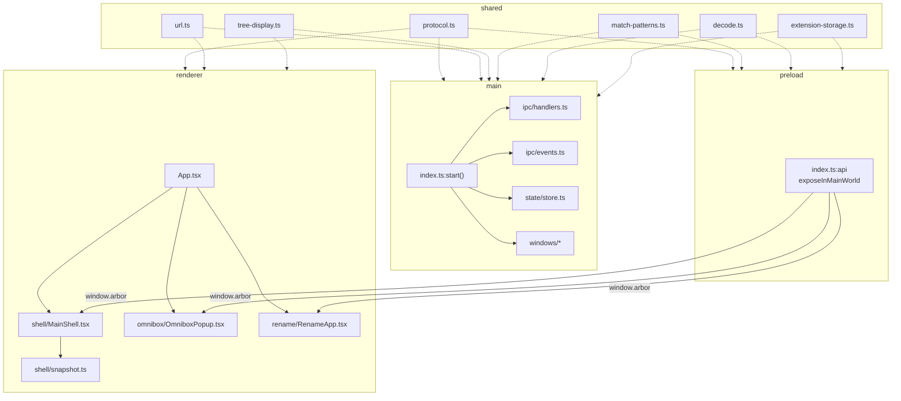
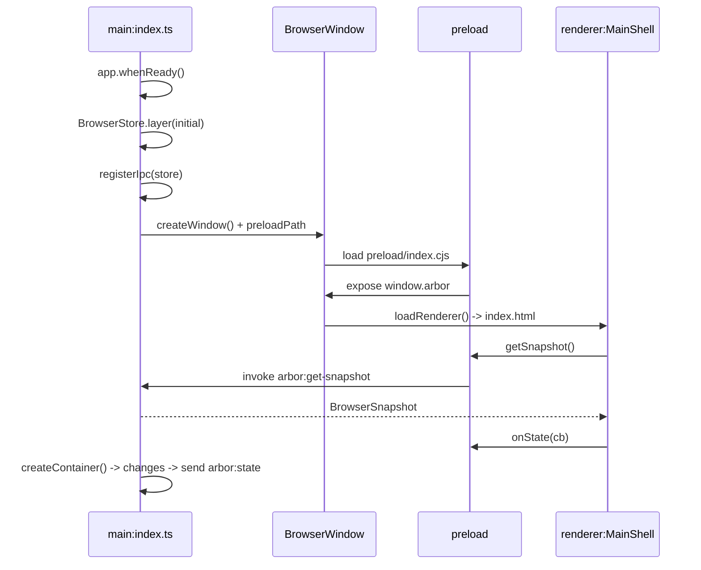

# Definitions

## 1. Main

- **Location**: `src/main/`
- **Runtime**: Node + Electron. Full OS access: windows, sessions, filesystem, menus.
- **Entry**: `src/main/index.ts` -> `start()`.
- **Owns**:
    - `BrowserStore`: sole mutable state.
    - `BrowserWindow` instances.
    - `WebContentsView` instances: 1 per tab, plus the shell view hosting `MainShell`.
    - `ipcMain` handlers.
    - `AppRuntime` (`runtime.ts`): the one Effect runtime. Every Effect runs on it, so one logging config applies everywhere: debug in `vp dev`, info otherwise, and warnings/errors appended to `arbor.log` in the OS logs folder outside dev. `tests/architecture.test.ts` fails on `Effect.run*` anywhere else.
- **Never**: renders sidebar DOM. No SolidJS here. No `console.*`: log with `Effect.log*`.

## 2. Preload

- **Location**: `src/preload/index.ts`
- **Runtime**: isolated bridge. Runs before renderer. Access to both `electron` and `window`.
- **Exposes**: `contextBridge.exposeInMainWorld("arbor", api)` -> `window.arbor: ArborApi`.
- **Contains**: no state, no logic. Thin wrappers only:
    - `invoke(channel, ...args)` for request/response.
    - `send(channel, ...args)` for fire-and-forget.
    - `on(channel, cb)` for subscriptions.
- **Type contract**: `src/preload/arbor.d.ts` -> `Window.arbor`.

## 3. Renderer

- **Location**: `src/renderer/`
- **Runtime**: Chromium sandbox. No Node, no `ipcRenderer` import.
- **Stack**: SolidJS 2.0. Reactive signals from snapshots.
- **Entry**: `src/renderer/App.tsx` -> 3 modes by query string.
- **Access**: `window.arbor` only.

## 4. Shared

- **Location**: `src/shared/`
- **Runtime**: none. Pure logic + types, no `electron` import.
- **Effect**: the renderer and preload load nothing from `effect` at runtime. They import schema modules (`protocol.ts`, `errors.ts`, `settings-schema.ts`) with `import type` only; runtime values live in schema-free modules (`constants.ts`, `settings.ts`). `tests/architecture.test.ts` follows imports to enforce it.
- **Membership**: only code loaded into **both** processes, main and renderer (the latter directly or through a preload). Code a single process uses belongs in that process's tree.
- **Contents**:
    - `protocol.ts`: Schemas for every shape crossing processes or onto disk (`TabId`, `ContainerId`, `TabNode`, `ContainerMeta`, `BrowserSnapshot`, IPC payloads, `Anchor` / `Rect`). Types derive from them (`typeof X.Type`). IDs are template literals (`` `tab-${string}` ``, `` `container-${string}` ``): distinct types, no runtime cost.
    - `errors.ts`: `DomainError`, a tagged union (`UnknownTab`, `UnknownContainer`, `LastTab`, `InvalidMove`, `EmptyContainer`, `NoContainer`, `NothingToReopen`).
    - `settings.ts` / `settings-schema.ts`: settings constants and helpers / the `Settings` and `SettingsPatch` schemas.
    - `constants.ts`: `CONTAINER_COLORS`, `CONTAINER_ICONS`, `containerPartition()`.
    - `url.ts`: `omniboxTarget()`, `isUrlLike()`.
    - `tree-display.ts`: `displayTabs()` -> flat rows + `depth`.
    - `match-patterns.ts`: `originsCoveredBy()` -> Chrome match-pattern subsumption.
    - `decode.ts`: `orDefault()`, `decodeOr()` -> lenient Effect Schema reads of untrusted JSON.
    - `extension-storage.ts`: `ExtStorageOp` wire types + pure `chrome.storage` semantics over plain objects.

# Process Map

# Startup Sequence

# Rules

- **Import direction**: main -> shared, preload -> shared, renderer -> shared. Never shared -> main.
- **Shared membership**: `src/shared/` holds only code loaded into both processes. Single-process code lives in `src/main/`, `src/preload/`, or `src/renderer/`.
- **No bypass**: renderer `import { ipcRenderer } from "electron"` -> forbidden. Use `window.arbor`.
- **Modes**: `loadRenderer(win)` = main shell. `loadRenderer(win, "omnibox"|"rename"|"extensions"|"permission")` = a popup or modal. Same bundle, one root per mode.
- **Internal pages**: `arbor://settings` is not a mode. It is served over Arbor's own protocol (`protocol.handle`, see `main/windows/internal-pages.ts`) into a tab's `WebContentsView`, with its route in the path. Its mode is chosen by protocol rather than query string, so it runs on the dedicated internal session and nothing else carries the preload bridge.
