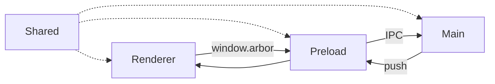
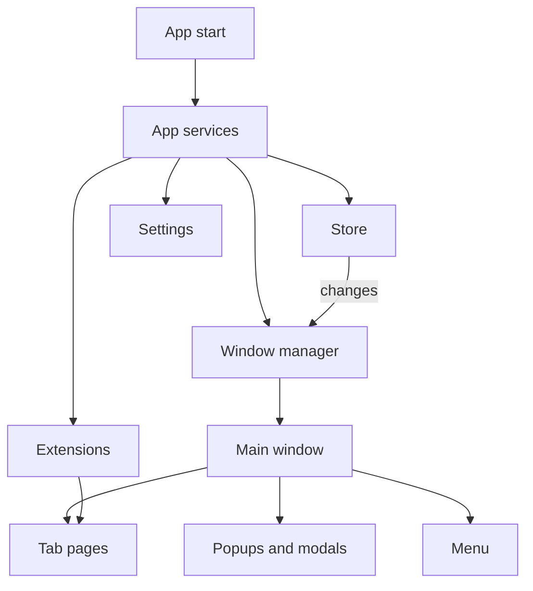
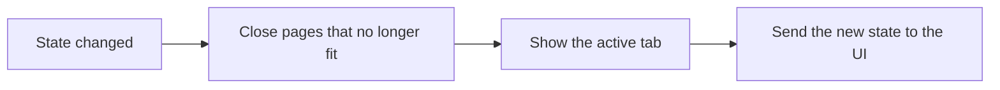
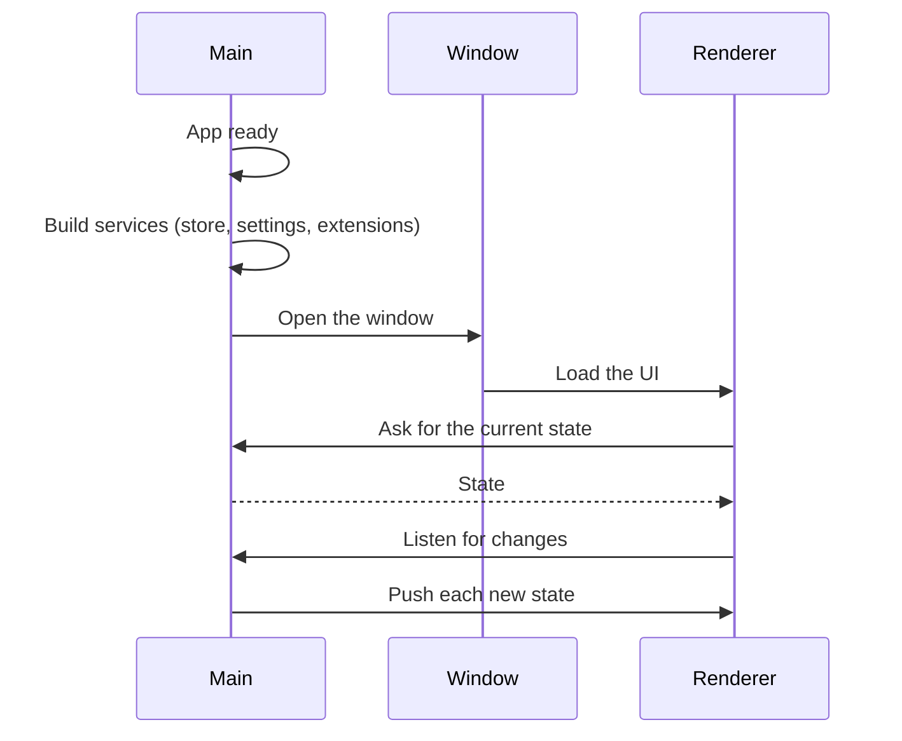
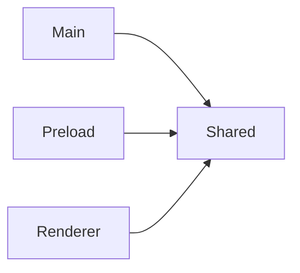

# Processes

Arbor is an Electron app. Its code lives in four parts.

| Part | Runs in | Role |
| --- | --- | --- |
| Main | Node + Electron | Owns the state, the window, the tab pages and the extensions |
| Preload | A small bridge | Exposes `window.arbor` to the UI |
| Renderer | Chromium | Draws the UI with SolidJS |
| Shared | Main and UI | Types and pure helpers used by both |

# Main

The main process does all the real work. It is built from a few modules.

- **Store**: holds the state. See [Store](03-store.md).
- **Window manager**: opens the window and keeps it in sync with the state.
- **Extensions**: installs and runs Chrome extensions in each container.
- **Saved data**: the state, the settings and the extension storage are saved to disk. A missing or broken file falls back to defaults.

## Keeping the window in sync

Each time the state changes, the window manager runs the same steps:

## Extensions

- Each container session gets the same extensions.
- New permissions ask the user first, one prompt at a time.
- Extension storage is shared by all containers.

# Preload

- A thin bridge between the UI and the main process.
- No state and no logic.
- Builds `window.arbor` from the list of IPC channels.

# Renderer

- The UI, built with SolidJS.
- No Node access. It only talks through `window.arbor`.
- One bundle with several modes: the main sidebar, the omnibox, rename, extensions and permission popups.
- Internal pages like `arbor://settings` load inside a tab, on their own session.

# Shared

- Code used by both the main process and the UI.
- Data shapes, error types, settings, URL helpers, tab tree display.
- No Electron code.

# Startup

# Rules

- Imports only go toward Shared, not the other way.
- Shared only holds code used by more than one process.
- The UI talks to the main process only through `window.arbor`.
- The source code holds nothing written only for tests. Tests swap whole modules instead.
