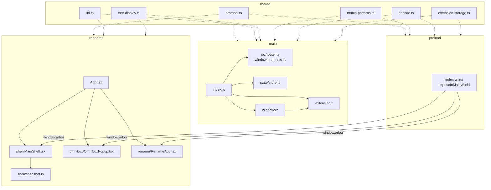
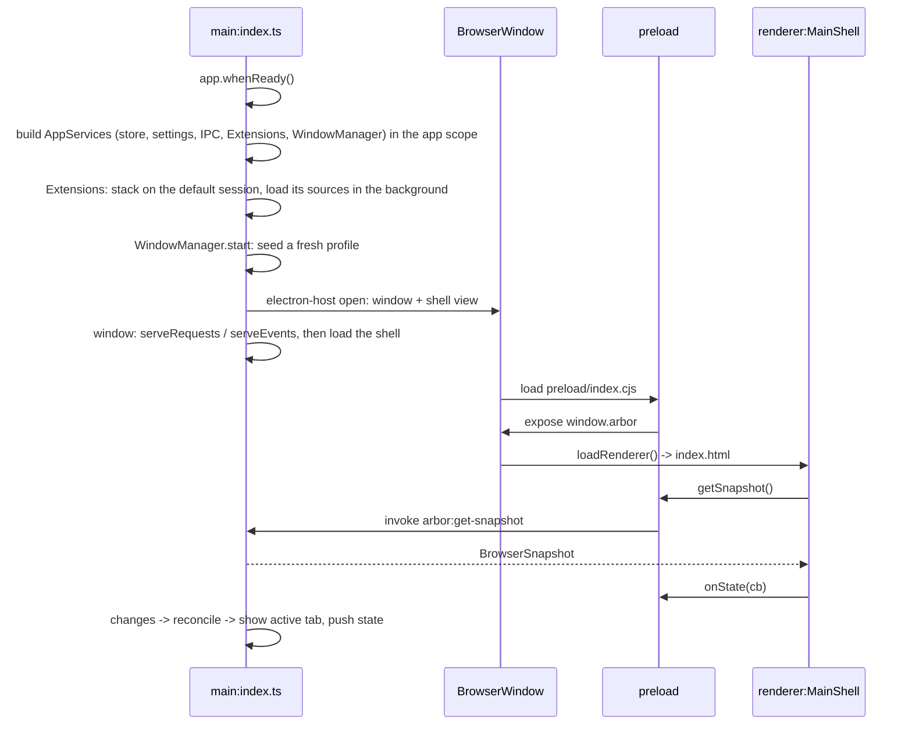

# Definitions

## 1. Main

- **Location**: `src/main/`
- **Runtime**: Node + Electron. Full OS access: windows, sessions, filesystem, menus.
- **Entry**: `src/main/index.ts`: registers `arbor://`, waits for `app.whenReady()`, builds `AppServices` into the app scope, runs `WindowManager.start`, and quits when it ends. One process per user: a second launch quits at once and focuses the running window (ADR 0004).
- **Owns**:
    - `BrowserStore`: sole mutable state.
    - The **WindowManager module** (`windows/window-manager.ts`): opens the main window and keeps it showing the store's state. One window per run: closing it quits the app (ADR 0004). See "Windows" below.
    - The **Extensions module** (`extension/extensions.ts`): the extension stack of every session. See "Extensions" below.
    - `ipcMain` handlers, served from the window scope through the IPC module (`02-ipc.md`).
    - `AppRuntime` (`runtime.ts`): the one Effect runtime. Every Effect runs on it, so one logging config applies everywhere: debug in `vp dev`, info otherwise, and warnings/errors appended to `arbor.log` in the OS logs folder outside dev. `tests/architecture.test.ts` fails on `Effect.run*` anywhere else.
- **Persistence** (`src/main/persistence/`): `state.json`, `settings.json` and `extension-storage.json`.
    - `json-file.ts`: typed reads and writes (`readJson`, `writeJson`; `FileMissing`, `FileUnreadable`, `FileUnwritable`). Tests replace `node:fs` with `tests/support/memory-fs.ts`.
    - `PersistedRef`: a value that loads itself, is read, modified and observed, and writes itself back, debounced. `persistChanges` is its writer alone, used for the store's state.
    - A missing file starts from defaults. An unusable one (bad JSON, unknown version, no live container) is logged and replaced by defaults on the next write.
    - `app-services.ts` builds the store, `Settings` and extension storage into the **app scope**. Quitting closes that scope: each writer flushes in its finalizer, so a new persisted file needs no quit wiring.
- **Windows** (`src/main/windows/`), one window per run (ADR 0004):
    - The WindowManager opens it once, just after the app services are built. Its scope holds the tab views, overlays, the window's IPC channels, reconciliation, the menu (rebuilt only when its model changes) and the settings broadcast. Closing the window closes that scope, ends `start`, and quits.
    - Reconciliation: on each `store.changes` emission one rule runs: close the views that no longer fit their tab (gone, or on the wrong session), show the active tab (creating its view), push the snapshot.
    - `electron-host.ts` (with `shell-view.ts`) is the Electron code this logic drives: open a window, load the shell, create/show/close/load a view, page events, history, shell raise/focus, window focus, second launches, the menu. Its types are in `windows/host.ts`. The WindowManager decides a tab's **session key** (`internal` for `arbor://`, its Container's otherwise); `electron-host.ts` maps keys to sessions.
    - Overlays (`overlays.ts`) stay behind Electron and are checked by hand.
    - `CurrentWindow` (`windows/current-window.ts`) is the main window for code outside the WindowManager: the Extensions module and the permission modal. Its operations (the Electron window, the overlays, `ensureTabView`, `tabIdFor`) wait for the window at startup; after that it is always there. The WindowManager hands the window over once it is open. It is its own service because the WindowManager needs both of its readers.
    - The overlays are built by the Electron host and reached through the port (`handle.overlays`).
- **Extensions** (`src/main/extension/`), all in the app scope:
    - **Extensions module** (`extensions.ts`): installs `electron-chrome-extensions` and the Web Store on a session, once. The default session gets it at startup (it hosts `<browser-action-list>`); a Container's session gets it from the Electron window host before its first view, so no session exists without its stack. Then, per session: Web Store installs and update checks, dev-only unpacked extensions from `./extensions` (asked first), MV3 worker start with retry, and a new extension copied to every other session. `ready(session)` completes once that is done: `chrome-extension://` loads wait on it.
    - It also answers the libraries' `chrome.tabs` / `chrome.windows` callbacks against the store (`chrome.tabs.create` makes the tab's view at once), serves the extension menu (Options, Pin, Uninstall), and owns uninstall: every session, then icon, storage, consent and pin. A Web Store "Remove" (`chrome.management.uninstall`) goes through the same teardown.
    - Every library callback runs on the module's runners, so none outlives the app scope. Each Electron promise is wrapped once, with a typed error (`ExtensionLoadFailed`, `WorkerStartFailed`, `UninstallFailed`), and logged with its `extensionId`.
    - It is checked by running the app. Tests of other modules use `tests/support/extensions.ts`.
    - **Consent** (`consent.ts`): what the user is asked and what is remembered, over the store's consent ledger. One prompt at a time; an unpacked extension denied once is not asked again that run. The modal is the `PermissionPrompts` service (`prompts.ts`): a window over the main window, shown by consent and answered by the `permissionRespond` event.
    - **Extension storage** (`storage.ts`): one `chrome.storage` for all Containers (Firefox-style). `local` is persisted, `session` lives in memory. It serves `arbor:ext-storage` on `ipcMain` for extension pages and on each service worker's own bus, for as long as the service lives.
- **Never**: renders sidebar DOM. No SolidJS here. No `console.*`: log with `Effect.log*`.

## 2. Preload

- **Location**: `src/preload/index.ts`
- **Runtime**: isolated bridge. Runs before renderer. Access to both `electron` and `window`.
- **Exposes**: `contextBridge.exposeInMainWorld("arbor", …)` -> `window.arbor: ArborApi`.
- **Contains**: no state, no logic, no code per channel. Built from the channel tables in `shared/ipc/channels.ts`:
    - one `invoke` method per request.
    - one `send` method per event.
    - one `on<Key>` subscription per push.
- **Type contract**: `ArborApi` in `shared/ipc/contract.ts`, declared on `Window` by `src/preload/arbor.d.ts`.
- **Sandboxed**: it can only `require("electron")`, so it loads nothing from `effect`. `vp run build` checks the built files.

## 3. Renderer

- **Location**: `src/renderer/`
- **Runtime**: Chromium sandbox. No Node, no `ipcRenderer` import.
- **Stack**: SolidJS 2.0. Reactive signals from snapshots.
- **Entry**: `src/renderer/App.tsx` -> 3 modes by query string.
- **Access**: `window.arbor` only.

## 4. Shared

- **Location**: `src/shared/`
- **Runtime**: none. Pure logic + types, no `electron` import.
- **Effect**: the renderer and preload load nothing from `effect` at runtime. They import schema modules (`protocol.ts`, `errors.ts`, `settings-schema.ts`, `ipc/contract.ts`) with `import type` only; runtime values live in schema-free modules (`constants.ts`, `settings.ts`, `ipc/channels.ts`). `tests/architecture.test.ts` follows imports to enforce it.
- **Membership**: only code loaded into **both** processes, main and renderer (the latter directly or through a preload). Code a single process uses belongs in that process's tree.
- **Contents**:
    - `ipc/channels.ts` / `ipc/contract.ts`: every IPC channel name / its schemas, `Reply` and `ArborApi`. See `02-ipc.md`.
    - `protocol.ts`: Schemas for every shape crossing processes or onto disk (`TabId`, `ContainerId`, `TabNode`, `ContainerMeta`, `BrowserSnapshot`, IPC payloads, `Anchor` / `Rect`). Types derive from them (`typeof X.Type`). IDs are template literals (`` `tab-${string}` ``, `` `container-${string}` ``): distinct types, no runtime cost.
    - `errors.ts`: `DomainError`, a tagged union (`UnknownTab`, `UnknownContainer`, `LastTab`, `InvalidMove`, `EmptyContainer`, `NoContainer`, `NothingToReopen`), plus the errors other requests answer (`SettingsRejected`, `NoActionPopup`).
    - `settings.ts` / `settings-schema.ts`: settings constants and helpers / the `Settings` and `SettingsPatch` schemas.
    - `constants.ts`: `CONTAINER_COLORS`, `CONTAINER_ICONS`, `containerPartition()`.
    - `url.ts`: `omniboxTarget()`, `isUrlLike()`.
    - `tree-display.ts`: `displayTabs()` -> flat rows + `depth`.
    - `match-patterns.ts`: `originsCoveredBy()` -> Chrome match-pattern subsumption.
    - `decode.ts`: `orDefault()`, `decodeOr()` -> lenient Effect Schema reads of untrusted JSON.
    - `extension-storage.ts`: `ExtStorageOp` wire types + pure `chrome.storage` semantics over plain objects.

# Process Map

# Startup Sequence

# Rules

- **No test code in `src/`**: nothing in `src/` exists for tests, not a branch, a `null`, an export or an interface. Tests swap modules for stand-ins with `vi.mock(path, () => import("./support/…"))`: `ipc/transport.ts` (`tests/support/ipc.ts`), `node:fs` (`tests/support/memory-fs.ts`), `windows/electron-host.ts` (`tests/support/window-host.ts`). Services that real code needs anyway (`PermissionPrompts`, `Extensions`) are replaced with `Layer.succeed` in the test.
- **Import direction**: main -> shared, preload -> shared, renderer -> shared. Never shared -> main.
- **Shared membership**: `src/shared/` holds only code loaded into both processes. Single-process code lives in `src/main/`, `src/preload/`, or `src/renderer/`.
- **No bypass**: renderer `import { ipcRenderer } from "electron"` -> forbidden. Use `window.arbor`.
- **Modes**: `loadRenderer(win)` = main shell. `loadRenderer(win, "omnibox"|"rename"|"extensions"|"permission")` = a popup or modal. Same bundle, one root per mode.
- **Internal pages**: `arbor://settings` is not a mode. It is served over Arbor's own protocol (`protocol.handle`, see `main/windows/internal-pages.ts`) into a tab's `WebContentsView`, with its route in the path. Its mode is chosen by protocol rather than query string, so it runs on the dedicated internal session and nothing else carries the preload bridge.
