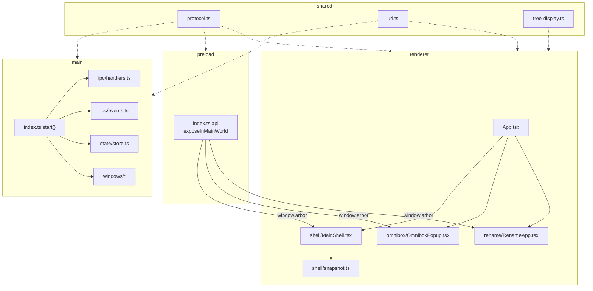
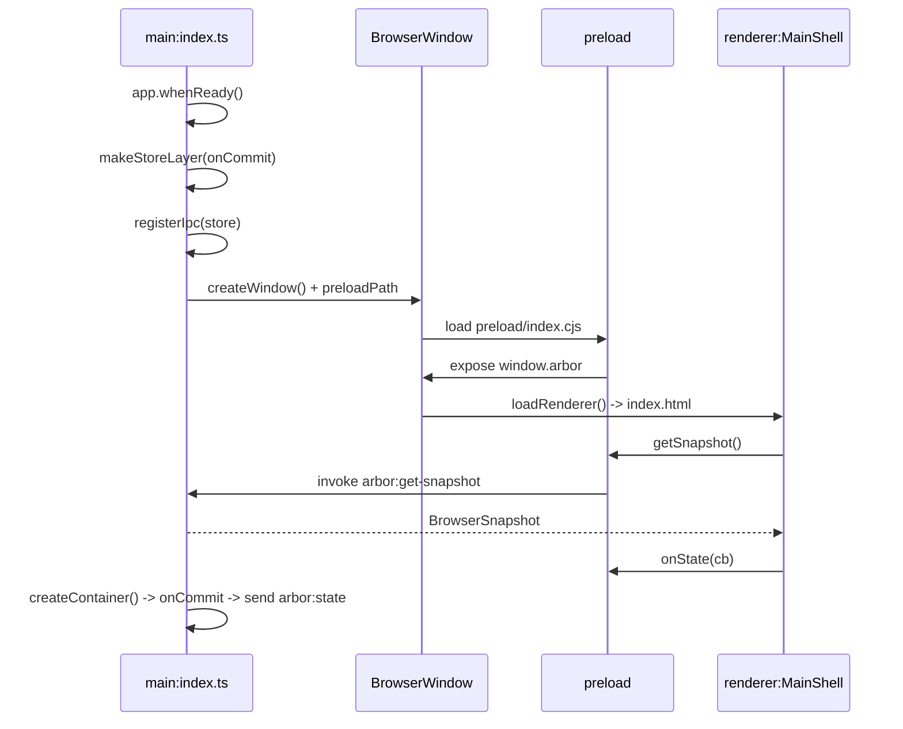

# Definitions

## 1. Main

- **Location**: `src/main/`
- **Runtime**: Node + Electron. Full OS access: windows, sessions, filesystem, menus.
- **Entry**: `src/main/index.ts` -> `start()`.
- **Owns**:
    - `BrowserStore`: sole mutable state.
    - `BrowserWindow` instances.
    - `WebContentsView` instances: 1 per tab.
    - `ipcMain` handlers.
- **Never**: renders sidebar DOM. No SolidJS here.

## 2. Preload

- **Location**: `src/preload/index.ts`
- **Runtime**: isolated bridge. Runs before renderer. Access to both `electron` and `window`.
- **Exposes**: `contextBridge.exposeInMainWorld("arbor", api)` -> `window.arbor: ArborApi`.
- **Contains**: no state, no logic. Thin wrappers only:
    - `invoke(channel, ...args)` for request/response.
    - `send(channel, ...args)` for fire-and-forget.
    - `on(channel, cb)` for subscriptions.
- **Type contract**: `src/preload/arbor.d.ts` -> `Window.arbor`.

## 3. Renderer

- **Location**: `src/renderer/`
- **Runtime**: Chromium sandbox. No Node, no `ipcRenderer` import.
- **Stack**: SolidJS 2.0. Reactive signals from snapshots.
- **Entry**: `src/renderer/App.tsx` -> 3 modes by query string.
- **Access**: `window.arbor` only.

## 4. Shared

- **Location**: `src/shared/`
- **Runtime**: none. Imported by main + preload + renderer.
- **Contents**:
    - `protocol.ts`: `ContainerId`, `TabId`, `BrowserSnapshot`, `RenameTarget`, `OmniboxActivation`, `CONTAINER_COLORS`, `CONTAINER_ICONS`.
    - `url.ts`: `omniboxTarget()`, `isUrlLike()`.
    - `tree-display.ts`: `displayTabs()` -> flat rows + `depth`.

# Process Map

# Startup Sequence

# Rules

- **Import direction**: main -> shared, preload -> shared, renderer -> shared. Never shared -> main.
- **No bypass**: renderer `import { ipcRenderer } from "electron"` -> forbidden. Use `window.arbor`.
- **Modes**: `loadRenderer(win)` = main shell. `loadRenderer(win, "omnibox")` = popup. `loadRenderer(win, "rename")` = modal. Same bundle, 3 roots.
