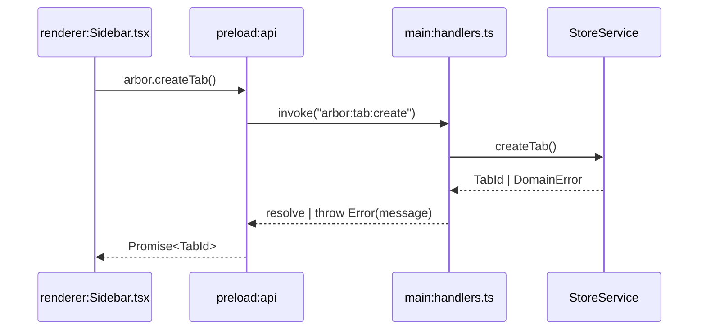
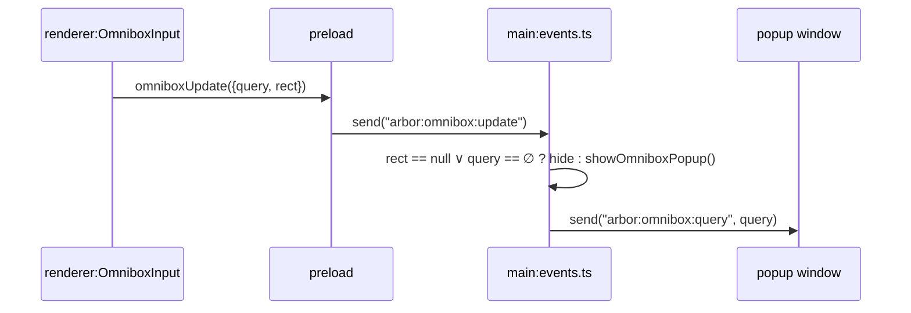
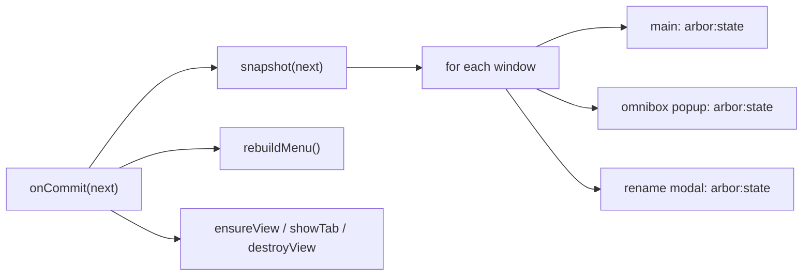
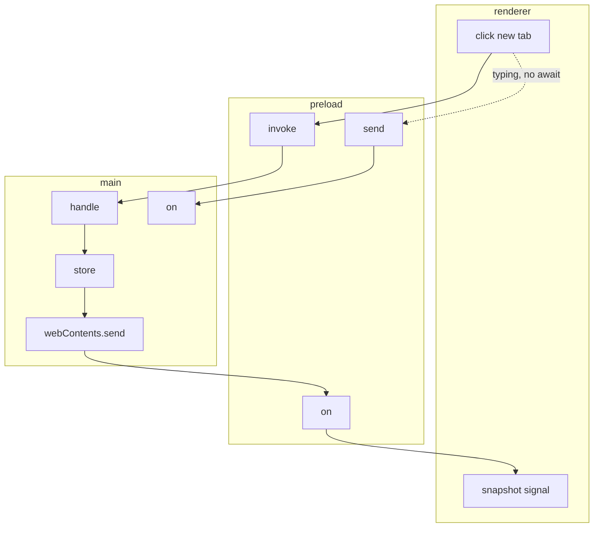

# Definition

- **IPC**: inter-process communication. Mechanism for renderer <-> main message passing across OS processes.
- **Need**: renderer and main run in separate processes with separate memory. No shared variables. Only serialized messages over channels.
- **Transport**: Electron `ipcMain` <-> `ipcRenderer`. Payloads: structured-cloneable values only. No functions, no class instances.

> Electron IPC: `ipcRenderer.invoke` + `ipcMain.handle` for two-way, `ipcRenderer.send` + `ipcMain.on` for one-way, `webContents.send` for main->renderer push.
> Source: _Electron docs -> ipcMain / ipcRenderer / webContents_.

# Patterns

## 1. Request/response

- **Use**: mutations + initial read. Caller awaits result or error.
- **Primitives**: `ipcRenderer.invoke(channel, ...args)` -> `ipcMain.handle(channel, fn)`.
- **Error path**: handler throws -> `invoke` promise rejects.

- **Channels**: `arbor:get-snapshot`, `arbor:container:*`, `arbor:tab:*` except navigation helpers.

## 2. Fire-and-forget

- **Use**: high-frequency or no-result events. No await.
- **Primitives**: `ipcRenderer.send(channel, payload)` -> `ipcMain.on(channel, fn)`.
- **Property**: lossy by design. Sender continues. No return value: `void`.

- **Channels**: `arbor:omnibox:update`, `arbor:omnibox:popup-height`, `arbor:omnibox:activate`, `arbor:omnibox:move-selection`, `arbor:omnibox:activate-selected`, `arbor:rename-modal:open`, `arbor:rename-modal:close`.

## 3. Push

- **Use**: main -> renderer broadcast. State commits, focus requests, popup navigation.
- **Primitives**: `win.webContents.send(channel, payload)` -> `ipcRenderer.on(channel, cb)` wrapped in preload.
- **Fan-out**: `for (w of getAllWindows()) w.send("arbor:state", snapshot)`. Popup and modal stay in sync without extra fetch.

# Renderer <-> Main

# Rules

1. Add channel in 3 places: `handlers.ts` or `events.ts` + `preload/index.ts` + call site in renderer.
2. Prefer `invoke` for state changes. Prefer `send` for input streams: `query_t` at 60Hz must not block on `await`.
3. Never send `DomainState` (`Map` inside). Send `BrowserSnapshot` (plain arrays). Relation: `snapshot = project(DomainState)`.
