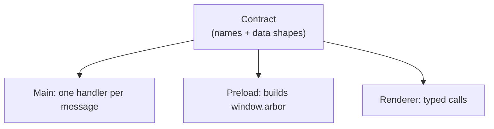
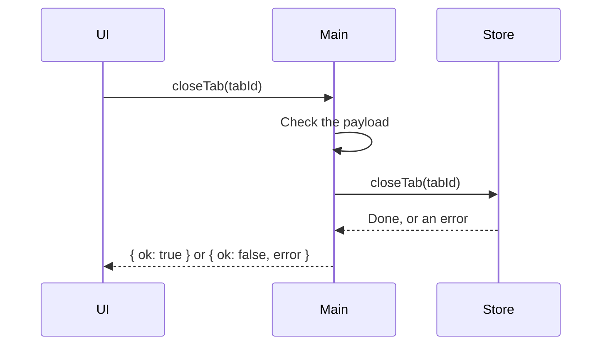
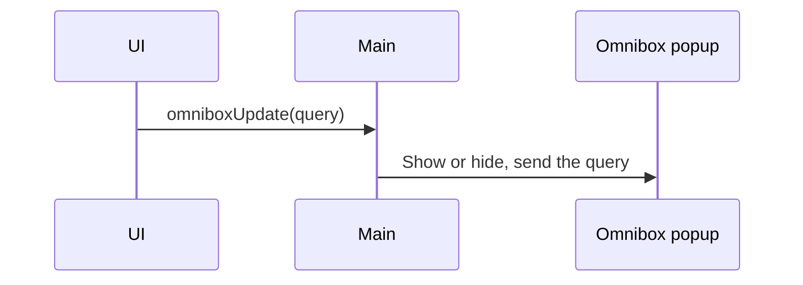
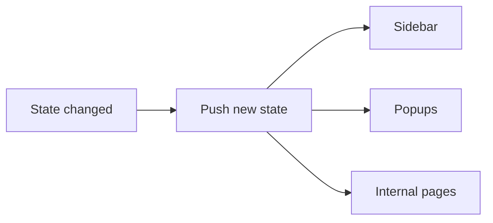

# IPC

The UI and the main process run in separate processes. They do not share memory. They talk by sending messages, called IPC.

# The Contract

Every message type is declared once, in Shared. Main, Preload and Renderer are all built from it.

- Adding a message to the contract makes the compiler ask for its handler.
- Main checks every incoming payload against its shape.
- Only messages in the contract can be called from the UI.

# Three Kinds of Messages

| Kind | Direction | Waits for an answer | Used for |
| --- | --- | --- | --- |
| Request | UI to main | Yes | Changing the state, first read |
| Event | UI to main | No | Fast input, like typing in the omnibox |
| Push | Main to UI | No | New state, new settings |

## Request

- Expected errors come back as values, like `{ ok: false, error: { _tag: "LastTab" } }`.
- A crash or a bad payload means a bug. Main logs it.

## Event

- No answer. A bad payload is logged and dropped.

## Push

- Sent to every Arbor UI that listens.
- Extension popups do not receive it.

# Rules

- Use requests to change the state.
- Use events for fast input that must not wait.
- Send a plain copy of the state, not the internal one.
