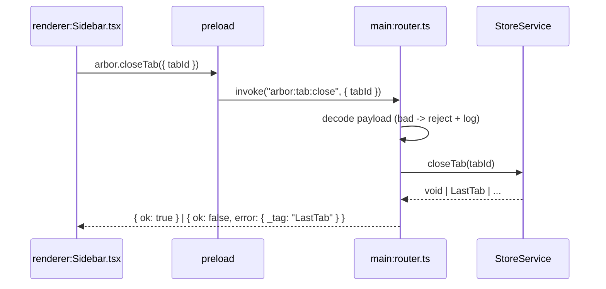
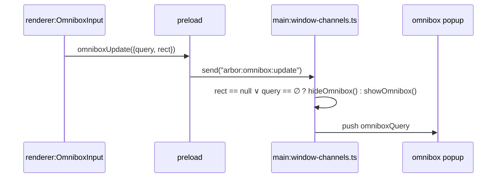
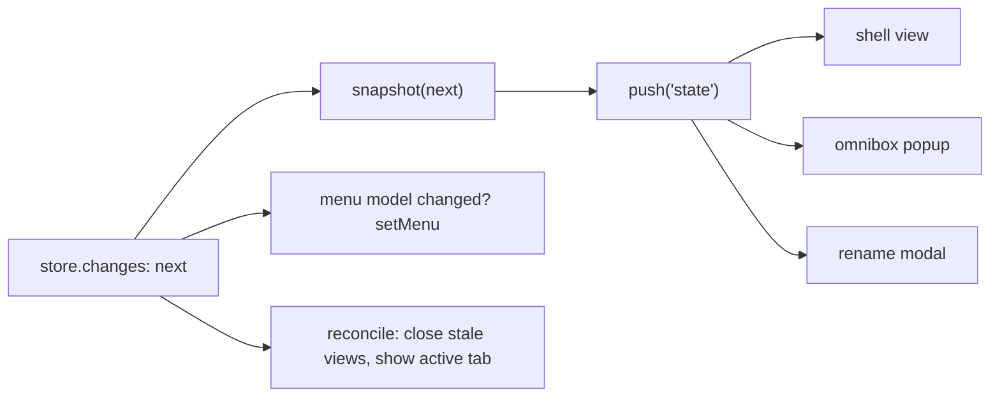

# Definition

- **IPC**: inter-process communication. Mechanism for renderer <-> main message passing across OS processes.
- **Need**: renderer and main run in separate processes with separate memory. No shared variables. Only serialized messages over channels.
- **Transport**: Electron `ipcMain` <-> `ipcRenderer`. Payloads: structured-cloneable values only. No functions, no class instances.

> Electron IPC: `ipcRenderer.invoke` + `ipcMain.handle` for two-way, `ipcRenderer.send` + `ipcMain.on` for one-way, `webContents.send` for main->renderer push.
> Source: _Electron docs -> ipcMain / ipcRenderer / webContents_.

# The contract

Every Arbor channel is declared once, in `src/shared/ipc/`:

- `channels.ts`: the channel names, one table per direction (`REQUESTS`, `EVENTS`, `PUSHES`). Imports nothing, so the sandboxed preload can load it.
- `contract.ts`: the schemas, with the same keys (`Requests`, `Events`, `Pushes`). A request has a `payload`, a `success` and an `error`; left out, they are void, void and never. The keys must match `channels.ts` or it does not compile.
- `ArborApi` (`window.arbor`) and `Reply` derive from it.

From the contract:

- **Main** (`src/main/ipc/router.ts`): `serveRequests(handlers)` and `serveEvents(handlers)` take one handler per key. The handlers (`ipc/window-channels.ts`) are built for one open window and served from its scope: every Arbor renderer lives in that window, so the channels go away with it. A missing handler, or an error the contract does not declare, does not compile. The router checks each payload against its schema, so handlers get typed values.
- **Preload** (`src/preload/index.ts`): builds `window.arbor` from the three tables. No code per channel. Only contract channels are reachable: never a generic `invoke(channel)`, which would expose the handlers extension libraries register on `ipcMain`.
- **Renderer**: calls take one payload object, e.g. `window.arbor.closeTab({ tabId })`.

`arbor:ext-storage` and `chrome.management.uninstall` stay outside the contract: they serve extension pages, not Arbor's.

# Patterns

## 1. Request/response

- **Use**: mutations + initial read. The caller awaits the answer.
- **Primitives**: `ipcRenderer.invoke(channel, payload)` -> `handle` in `ipc/transport.ts`.
- **Answer** (`Reply`): `{ ok: true, value }` or `{ ok: false, error }`, `error` being the encoded tagged error (`{ _tag: "LastTab" }`). A request that cannot fail is always `ok: true`.
- **Rejection** means a bug: a payload that fails its schema, or a defect in a handler. Main logs it with its full cause.

- Fire-and-forget calls (`void window.arbor.closeTab(…)`) ignore `ok: false`. The UI shows a failure only where it has a place for one: the settings page shows `SettingsRejected`'s message.

## 2. Fire-and-forget

- **Use**: high-frequency or no-result events. No await.
- **Primitives**: `ipcRenderer.send(channel, payload)` -> `on` in `ipc/transport.ts`.
- **Property**: lossy by design. A bad payload is logged in main and dropped.

## 3. Push

- **Use**: main -> renderer. State commits, settings changes, focus requests, popup navigation.
- **Primitives**: `IpcPush.push(key, value)` -> `ipcRenderer.on` wrapped in preload as `window.arbor.on<Key>`.
- **Audience**: every renderer that called `attach`: the shell view, the omnibox and extensions popups, the rename and permission modals, and tabs showing an `arbor://` page. A renderer leaves when its web contents is destroyed. Extension popups never attach, so they never get Arbor's state.
- `state` is pushed by the window's reconciliation, `settings` by the window's settings broadcast.
- `push` encodes once and sends to all. Each push has one listener mode, so a renderer simply ignores the pushes it does not listen to.

# Testing

`tests/ipc.test.ts` serves the contract with the real store. It replaces `ipc/transport.ts` with the in-memory version in `tests/support/ipc.ts` (`vi.mock`): src holds no code for tests.

# Rules

1. Declare a channel in `channels.ts` and `contract.ts`; the compiler then asks for the handler.
2. Prefer requests for state changes. Prefer events for input streams: `query_t` at 60Hz must not block on `await`.
3. Never send `DomainState` (`Map` inside). Send `BrowserSnapshot` (plain arrays). Relation: `snapshot = project(DomainState)`.
4. The preload imports `channels.ts` at runtime and `contract.ts` with `import type` only. `vp run build` checks that every built preload requires only `electron`.
