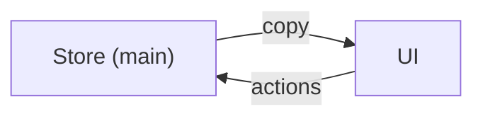
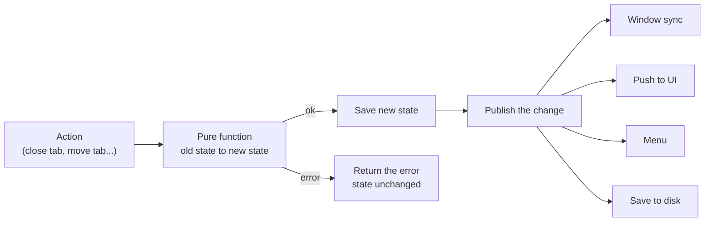
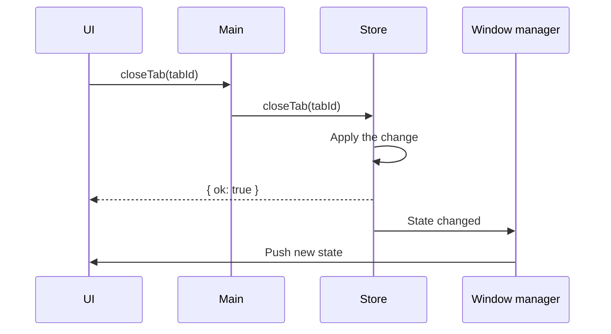
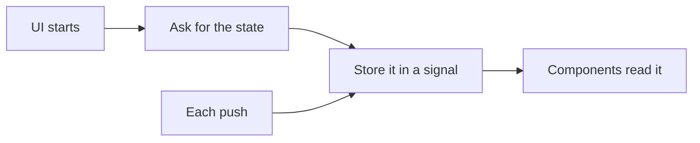
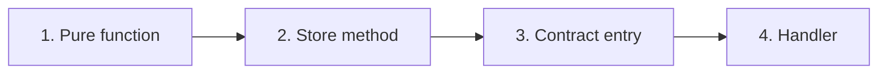

# Store

The store holds the whole browser state: containers, tabs, tab tree and closed tabs.

# Why One Store

Tab pages, menus, popups and the sidebar all depend on the same data. One store in the main process keeps them in sync. The UI only holds a read-only copy.

# How a Change Works

- Each change is a pure function: it takes the state and returns a new state or an error.
- Pure functions do not read the clock or make IDs. The store passes those in.
- A change that changes nothing publishes nothing.
- Each real change is published once.

# Full Example

# UI Copy

- Tab rows are reused when nothing visible changed. _For example to not make favicons blink._

# Adding a New Action

- Keep the function pure. Return errors as values.
- Side effects, like loading a page, stay outside the store.
