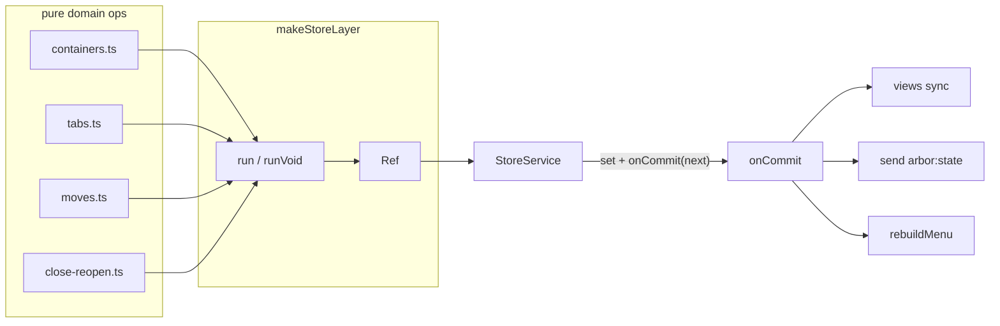
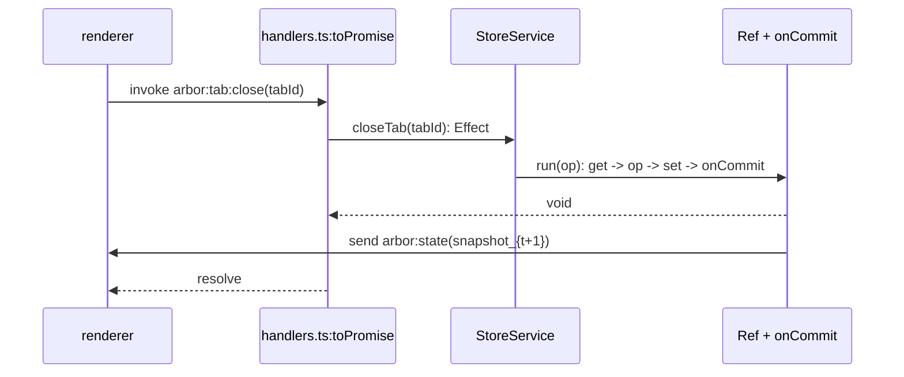
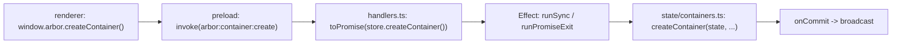

# Problem

- **Why central store**: views, sessions, menus, popups all derive from one truth. Renderer copies would desync: `views ≠ snapshot` on every race.
- **Decision**: main owns `DomainState`. Renderer holds `BrowserSnapshot_t`, read-only projection. See `docs/adr/0003-main-process-owns-state.md`.

# Components

## 1. `DomainState`

- **Location**: `src/main/state/state.ts`
- **Shape**: `{ containers: ContainerMeta[], tabs: Map<TabId, TabNode>, closeHistory: ClosedSubtree[], activeContainerId }`.
- **Property**: `Map`, not array. Lookup cost O(1). Snapshot converts to array for IPC: `tabs: [...map.values()]`.

## 2. `StoreService`

- **Location**: `src/main/state/store.ts`
- **Role**: typed capability interface. Lists every allowed mutation. Return type per op: `Effect<A, DomainError>`.
- **Ops**: `snapshot`, `createContainer`, `switchContainer`, `renameContainer`, `setContainerColor`, `setContainerIcon`, `reorderContainer`, `createTab`, `createChildTab`, `selectTab`, `setCollapsed`, `renameTab`, `closeTab`, `reopenTab`, `moveTab`, `moveToContainer`, `updateTabMeta`.
- **Why interface + service key**: Effect dependency injection. `BrowserStore = Context.Service<BrowserStore, StoreService>()("arbor.BrowserStore")`. Tests swap implementations. Handlers depend on interface, not constructor.

## 3. `makeStoreLayer(onCommit)`

- **Role**: factory. Builds live `StoreService` from `Ref<DomainState>` + commit hook.
- **Internals**:
    - `ref = Ref.make(initialState())`.
    - `run(op, pick)`: `get(ref)` -> `try(op)` -> `set(ref, next)` -> `onCommit(next)` -> `return pick(next)`.
    - `runVoid(op) = run(op, () => undefined)`.
- **Law**: `state_{t+1} = op(state_t)` atomically. Every mutation triggers exactly 1 `onCommit`. No silent writes.

# Flow

# Why Two Files

- **`store.ts`**: Effect shell. Concurrency, errors, commit hook. No tree math.
- **`preload/index.ts`**: IPC shell. Serialization boundary. No domain logic.
- **Relation**: `preload.api[f] ≈ invoke(store[f])`. Types mirror 1:1. Example: `createContainer(name?, color?) -> Promise<ContainerId>` on both sides.
- **Separation payoff**: change transport (e.g. add validation) in preload. Change semantics (e.g. promotion on close) in `close-reopen.ts`. Neither leaks into the other.

# Renderer Cache

- **Location**: `src/renderer/shell/snapshot.ts`
- **Pattern**: `initState()` once: `setSnapshot(await getSnapshot())` + `onState(setSnapshot)`.
- **Signal**: `useSnapshot(): Signal<BrowserSnapshot | null>`. All components derive from it.
- **Stabilization**: `stableDisplayTabs()` reuses previous `DisplayTab` reference when `sameDisplay(a,b)` holds. Prevents `<For>` remount blink on favicon ``. Excluded from comparison: `collapsed`, `order` (position handled by array move).

# Rules

1. Add mutation in 4 steps: pure op in `state/*.ts` -> method on `StoreService` -> wiring in `makeStoreLayer` -> `handle()` in `handlers.ts` + `api` in preload.
2. Keep ops pure: `(state) -> state`. Side effects (`loadURL`, `send`) live in `events.ts` / `handlers.ts` / `onCommit` only.
3. Convert errors at boundary: `DomainError{message} -> throw new Error(message)` via `toPromise()`. Renderer receives rejected promise with `message: string`.
