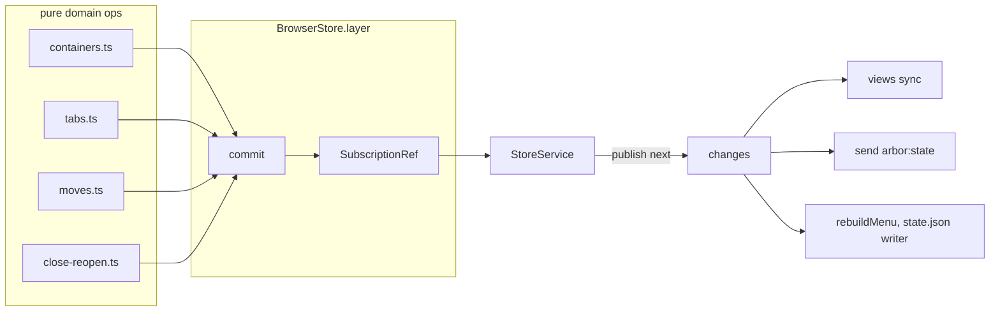
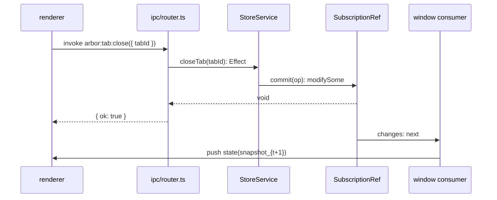
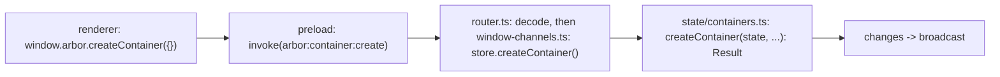

# Problem

- **Why central store**: views, sessions, menus, popups all derive from one truth. Renderer copies would desync: `views ≠ snapshot` on every race.
- **Decision**: main owns `DomainState`. Renderer holds `BrowserSnapshot_t`, read-only projection.

# Components

## 1. `DomainState`

- **Location**: `src/main/state/state.ts`
- **Shape**: `{ containers: ContainerMeta[], tabs: Map<TabId, TabNode>, closeHistory: ClosedSubtree[], activeContainerId }`.
- **Property**: `Map`, not array. Lookup cost O(1). Snapshot converts to array for IPC: `tabs: [...map.values()]`.

## 2. `StoreService`

- **Location**: `src/main/state/store.ts`
- **Role**: typed capability interface. Lists every allowed mutation. Each method's error type is its op's precise union (e.g. `closeTab: Effect<void, UnknownTab | UnknownContainer | LastTab>`), read off the op's `Result`.
- **Reads**: `state` (current `DomainState`), `changes` (stream: current state on subscribe, then every effective change once), `snapshot`.
- **Ops**: `createContainer`, `switchContainer`, `renameContainer`, `setContainerColor`, `setContainerIcon`, `reorderContainer`, `createTab`, `createChildTab`, `selectTab`, `setCollapsed`, `renameTab`, `closeTab`, `reopenTab`, `moveTab`, `moveToContainer`, `updateTabMeta`.
- **Why interface + service key**: Effect dependency injection. `BrowserStore = Context.Service<BrowserStore, StoreService>()("arbor.BrowserStore")`. Tests swap implementations. Handlers depend on interface, not constructor.

## 3. `BrowserStore.layer(initial)`

- **Role**: builds the live `StoreService` on a `SubscriptionRef<DomainState>`.
- **Ops**: pure functions `(state, …) -> Result<DomainState, E>` in `state/*.ts`. They never throw, read no clock and make no IDs: the store passes `id` and `now` in (`Clock`, so tests pin time with `TestClock`).
- **Internals**:
    - `ref = SubscriptionRef.make(initial)`.
    - `commit(op)`: `SubscriptionRef.modifySome(ref, op)` atomically. A failed `Result` leaves the ref unchanged and becomes the effect's typed failure (`Effect.fromResult`), never a defect. An op returning the same state is a no-op. Otherwise the ref is set and `changes` publishes `next`.
- **Law**: `state_{t+1} = op(state_t)` atomically. Every effective mutation publishes exactly once on `changes`; failures and no-ops publish nothing. Consumers run on their own fibers, so a consumer cannot fail a mutation.
- **Persistence**: `persistence/state-file.ts` builds the store from `state.json` and feeds `changes` to a debounced writer in the app scope (see `01-processes.md`).
- **Consumers** (the WindowManager module): the menu (rebuilt only when its model changes), and reconciliation (view sync + `arbor:state` broadcast; its first emission shows the current state as the window opens).

# Flow

# Why Two Files

- **`store.ts`**: Effect shell. Concurrency, IDs, time, change stream. No tree math.
- **`shared/ipc/contract.ts`**: IPC boundary. Payload, success and error schemas per channel. No domain logic.
- **Relation**: `window.arbor[f](payload) ≈ store[f](...)`, through a one-line handler in `ipc/window-channels.ts`. The contract declares the same error union as the store method, and the compiler checks the handler against it.
- **Separation payoff**: change the wire (e.g. a new field) in the contract. Change semantics (e.g. promotion on close) in `close-reopen.ts`. Neither leaks into the other.

# Renderer Cache

- **Location**: `src/renderer/shell/snapshot.ts`
- **Pattern**: `initState()` once: `setSnapshot(await getSnapshot())` + `onState(setSnapshot)`.
- **Signal**: `useSnapshot(): Signal<BrowserSnapshot | null>`. All components derive from it.
- **Stabilization**: `stableDisplayTabs()` reuses previous `DisplayTab` reference when `sameDisplay(a,b)` holds. Prevents `<For>` remount blink on favicon ``. Excluded from comparison: `collapsed`, `order` (position handled by array move).

# Rules

1. Add mutation in 4 steps: pure op in `state/*.ts` -> method on `StoreService` -> wiring in `BrowserStore.layer` -> a key in `shared/ipc/channels.ts` and `contract.ts` -> the handler in `ipc/window-channels.ts` (the compiler asks for it).
2. Keep ops pure: `(state, …) -> Result<DomainState, E>`, failures as tagged errors from `shared/errors.ts`, never `throw`. Side effects (`loadURL`, `send`) live in `ipc/window-channels.ts`, the WindowManager module and other `changes` consumers only.
3. Errors cross the boundary as values: the router encodes a store failure into `{ ok: false, error: { _tag, … } }`. Only bugs reject.
