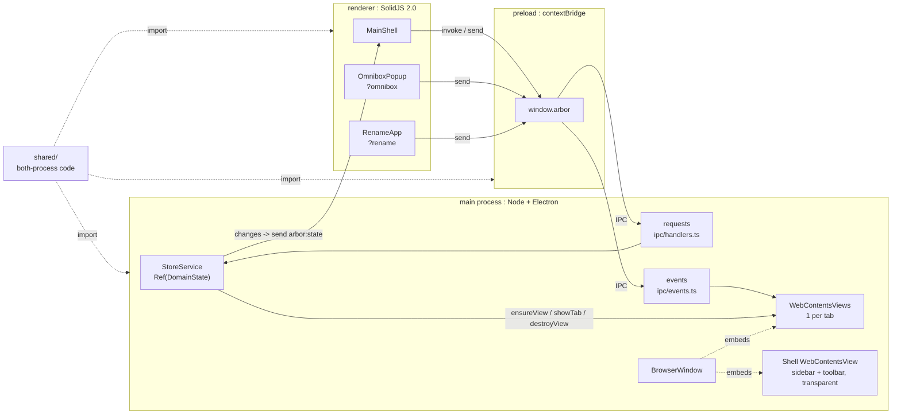

# Architecture

**Language**
English

# Index

1. **Processes**: `01-processes.md` -> definitions: main, preload, renderer, shared.
2. **IPC**: `02-ipc.md` -> channels, patterns, direction.
3. **Store**: `03-store.md` -> `StoreService`, Effect, snapshot flow.

# Topology

- **Rule**: main owns state + views. Renderer owns pixels. Preload owns bridge. Shared owns both-process code.
- **Constraint**: renderer -> main only via `window.arbor`. No direct `require("electron")` in renderer.

# Data Laws

- **Single writer**: `state_{t+1} = op(state_t)` in main only. Renderer holds `snapshot_t`, read-only.
- **Fan-out**: 1 commit -> _n_ windows: `send(arbor:state)` to all `BrowserWindow.getAllWindows()`.
- **Isolation**: `session(container_id) = containerPartition(id)` = `persist:container-{id}`. Cross-container move -> destroy + recreate view.
- **Stacking**: the shell renders in its own transparent `WebContentsView` (`main/windows/shell-view.ts`), a sibling of the tab views, never in the window's own webContents (which always paints beneath child views). At rest: shell below the active tab, tab bounds = window minus `chromeInsets(settings)`. While a hidden/compact bar is revealed: renderer sends `arbor:shell:raise` -> shell above the tab, bar slides over the page. Main reports the pointer reaching a hidden bar's edge over a page as `arbor:shell:edge` (the shell cannot see it there).
