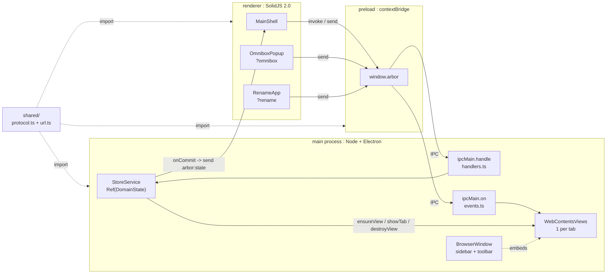

# Architecture

**Language**
English

# Index

1. **Processes**: `01-processes.md` -> definitions: main, preload, renderer, shared.
2. **IPC**: `02-ipc.md` -> channels, patterns, direction.
3. **Store**: `03-store.md` -> `StoreService`, Effect, snapshot flow.

# Topology

- **Rule**: main owns state + views. Renderer owns pixels. Preload owns bridge. Shared owns types.
- **Constraint**: renderer -> main only via `window.arbor`. No direct `require("electron")` in renderer.

# Data Laws

- **Single writer**: `state_{t+1} = op(state_t)` in main only. Renderer holds `snapshot_t`, read-only.
- **Fan-out**: 1 commit -> *n* windows: `send(arbor:state)` to all `BrowserWindow.getAllWindows()`.
- **Isolation**: `session(container_id) = persist:container-{id}`. Cross-container move -> destroy + recreate view.
