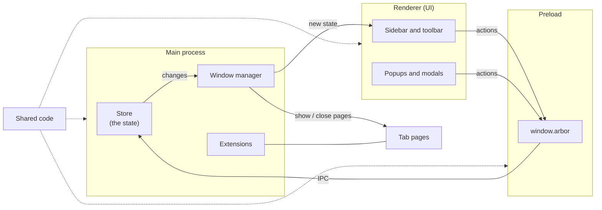

# Architecture

A short map of how Arbor works. Read it in order:

1. [Processes](01-processes.md): the four parts of the app and what each one does.
2. [IPC](02-ipc.md): how the UI and the main process talk.
3. [Store](03-store.md): where the state lives and how it changes.

# Big Picture

# Key Ideas

- One source of truth: Only the main process changes the state. The UI gets a read-only copy. |
- One way flow: UI sends an action, the store changes, the new state goes back to the UI. |
